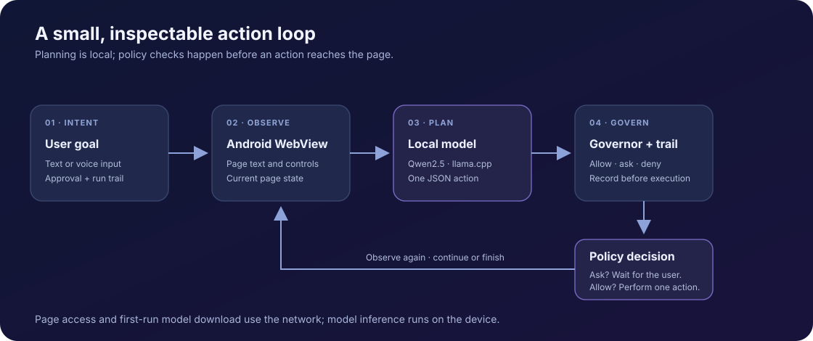

<div align="center">
  
  <h1>Ghost Hands Mobile</h1>
  <p><strong>A goal-driven web agent that runs on Android, with a local language model and a human-aware action governor.</strong></p>
</div>

Ghost Hands turns a plain-language goal into a sequence of small browser actions. It observes pages in an Android `WebView`, asks an on-device Qwen model what to do next, checks the proposed action against a policy, and records the run in a readable trail.

> **Project status:** This repository contains an Android proof app and a more capable mobile app. It is a hands-on prototype, not a published consumer release. Website compatibility and task success depend on the page, device, and chosen policy.

## See how it works



### Example goal

> “Find the posted opening hours for the museum and summarize them.”

An illustrative run might navigate to a page, read visible content, note relevant facts, and return a summary. The planner uses a small JSON action vocabulary, for example:

```json
{"action":"read"}
{"action":"note","fact":"The museum is open from 10:00 to 17:00."}
{"action":"done","summary":"The posted hours are 10:00–17:00."}
```

These are examples of the action format, not a recording of a successful run. Policy packs can allow, ask for approval, or deny actions; consequential actions are subject to the active policy.

## What’s in this repository?

| App | Location | What it does |
| --- | --- | --- |
| **Ghost Hands Mobile** | [`v1/`](v1/) | Goal-driven web agent with text and voice goals, model selection, policy packs, action approvals, saved goals and routes, run history, and answer cards. Android manifest version: `3.4.0`. |
| **Ghost Hands Proof** | [`app/`](app/) | A small on-device inference proof: downloads a quantized model, verifies it, and runs a repeatable benchmark. It is not the main app. |

The mobile app uses framework-only Java and a JNI bridge to `llama.cpp`. Its Qwen2.5-1.5B GGUF models are downloaded on demand to app-private storage; they are not checked into this repository or bundled in the APK. The proof app downloads its own Qwen2.5-1.5B model.

## A few design choices

- **One action at a time:** the agent observes the current page, plans a small action, and then observes again.
- **Policy before execution:** actions pass through the Governor, which classifies actions and applies the selected policy.
- **Visible run history:** the trail records decisions and outcomes; the UI also provides an answer card for a finished run.
- **Local inference, networked browsing:** model inference runs on the device after the model download. Loading websites and initially downloading a model require network access. Voice entry uses Android’s speech-recognition framework.
- **Small, native Android implementation:** Java, Android framework UI, `WebView`, JNI, and `llama.cpp`; no AndroidX or Kotlin.

## Build notes

There is no Gradle wrapper or self-contained build environment in this repository. The shell scripts expect a local JDK 17, Android SDK build-tools `34.0.0` and platform `android-34`, Android NDK `r27`, and a separate `llama.cpp` source checkout. They also contain workspace-specific paths, so a fresh clone is **not** a one-command build: review and adapt those paths and the signing setup before running them.

The scripts are:

- Proof app: [`native/build-llama.sh`](native/build-llama.sh), then [`build-apk.sh`](build-apk.sh).
- Mobile app: first build the native libraries, then [`v1/build-apk.sh`](v1/build-apk.sh).

Both builds target `arm64-v8a` and Android API 24+. The first app launch downloads the selected model (about 1.1–1.3 GB), so allow sufficient storage and network data. **Do not use the repository’s sample signing configuration for a public release.** Use a private release keystore and protect its credentials.

## Repository map

```text
app/                 On-device inference proof app
native/              Proof app's llama.cpp build and JNI shim
v1/app/              Main mobile app
v1/native/           Main app's JNI shim
v1/test/             Host-side Java tests
parity-lab/          Web perception/action experiments
read-lab/            Page-reading experiments
docs/                Diagrams for this README
```

## Contributing

Start with a focused issue or pull request. For changes to agent behavior, include the scenario being addressed and how it was checked; for UI changes, include a device screenshot when available. Keep model files, APKs, signing keys, and build outputs out of commits.
